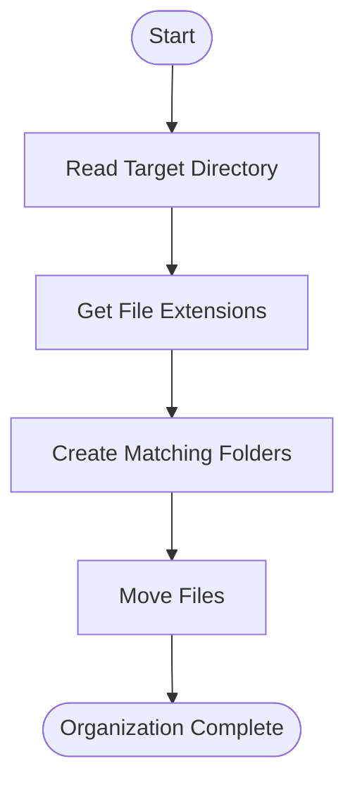

# 📂 File Organizer

\<p align="center">   \   \   \   \ \</p>

A simple Python automation project that organizes files into folders based on their extensions.

Tired of a Downloads folder full of random files? This little script helps bring some order to the chaos. 💀

## 🎬 See It in Action

\<!-- Add your recorded demonstration GIF here -->

\<!-- Save it as assets/demo.gif inside this project -->


*No more manually sorting every file. Let Python handle the boring stuff.*

## ✨ Features

- Detects file extensions.
- Automatically creates folders.
- Moves files into matching folders.
- Uses Python's built-in modules.
- No external libraries required.

## 🧠 How It Works



### Before

```text
Downloads/
├── anime.jpg
├── assignment.pdf
├── gameplay.mp4
├── music.mp3
└── notes.txt
```

### After

```text
Downloads/
├── jpg/
│   └── anime.jpg
├── pdf/
│   └── assignment.pdf
├── mp4/
│   └── gameplay.mp4
├── mp3/
│   └── music.mp3
└── txt/
    └── notes.txt
```

## 🛠️ Tech Stack

- Python 3.14
- `os`
- `shutil`

## 🚀 Getting Started

### Requirements

- Python 3.14
- Windows, Linux, or macOS
- A desktop PC or laptop
- A directory containing files to organize

**Mobile phones? Not invited.** ☠️

### Installation

Clone the repository:

```bash
git clone https://github.com/Sufyan-m/Python-Mini-Projects.git
```

Navigate to the project:

```bash
cd Python-Mini-Projects/File-Organizer
```

Open `main.py` and update the folder path:

```python
folder_path = r"C:\Users\YourName\Downloads"
```

Run:

```bash
python main.py
```

**Note:** Test with a sample directory first. The program moves files, so back up important data before running it.

\<details> \<summary>📚 What I Learned\</summary>

- Python file handling with `os`.
- Moving files using `shutil`.
- Extracting extensions with `os.path.splitext()`.
- Creating directories with `os.makedirs()`.
- Using loops and conditions for automation.

\</details>

\<details> \<summary>🔮 Future Improvements\</summary>

- Better error handling.
- Duplicate filename handling.
- Preview before moving files.
- Interactive folder selection.

\</details>

## 👨‍💻 Author

**Sufyan-m**

Python learner | Automation enthusiast | Gamer | Anime fan

GitHub: [@Sufyan-m](https://github.com/Sufyan-m)

---

Part of **Python Mini Projects**, a collection of small projects built while learning Python.

*One project at a time. One bug at a time.*
