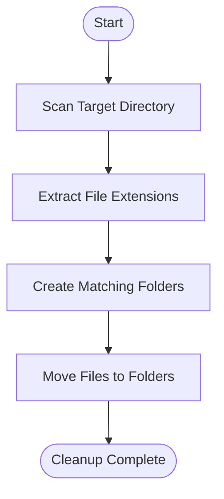

# 📂 File Organizer

`🐍 Python 3.8+` • `💻 Windows | Linux | macOS` • `📦 Dependencies: None` • `🎯 Level: Beginner`


A lightweight Python automation script that automatically sorts messy files into clean folders based on their file extensions.

Tired of a `Downloads` folder looking like a digital junkyard? Run this script once and watch it clean up the mess in seconds. 💀

## ✨ Features

- Automatically detects file extensions (`.pdf`, `.jpg`, `.mp4`, etc.).
- Creates separate folders for each file type if they don't exist.
- Safely moves files into their matching folders.
- Built using 100% Python standard libraries (no `pip install` needed).

## 🧠 How It Works



### Folder Structure (Before vs. After)

**Before:**
```text
Downloads/
├── anime.jpg
├── assignment.pdf
├── gameplay.mp4
├── music.mp3
└── notes.txt
```

**After:**
```text
Downloads/
├── jpg/
│   └── anime.jpg
├── pdf/
│   └── assignment.pdf
├── mp4/
│   └── gameplay.mp4
├── mp3/
│   └── music.mp3
└── txt/
    └── notes.txt
```

## 🛠️ Built With

- **Python 3.8+**
- `os` — for reading directories and handling file paths
- `shutil` — for moving files across folders

## 🚀 Getting Started

### Prerequisites

- Python 3.8 or higher installed on your PC
- Windows, Linux, or macOS *(Mobile phones not supported ☠️)*

### Setup & Usage

1. **Clone the repository:**
   ```bash
   git clone https://github.com/Sufyan-m/python-mini-projects.git
   ```

2. **Navigate to the project folder:**
   ```bash
   cd python-mini-projects/File-Organizer
   ```

3. **Set your target folder path** inside `main.py`:
   ```python
   folder_path = r"C:\Users\YourName\Downloads"
   ```

4. **Run the script:**
   ```bash
   python main.py
   ```

> **⚠️ Pro Tip:** Always test the script on a sample/dummy folder first before running it on your main `Downloads` or `Desktop` folder!

<details>
<summary>📚 What I Learned</summary>

- Navigating directories and listing files using `os.listdir()`.
- Splitting filenames and extensions cleanly with `os.path.splitext()`.
- Creating folders safely without errors using `os.makedirs(..., exist_ok=True)`.
- Automating file transfers with `shutil.move()`.

</details>

<details>
<summary>🔮 Future Improvements</summary>

- Group similar extensions together (e.g., `.jpg` and `.png` into an `Images` folder).
- Handle duplicate filenames without overwriting existing files.
- Add an "Undo" feature or dry-run preview mode.
- Build a simple GUI or interactive CLI folder picker.

</details>

## 👨‍💻 Author

**Sufyan** — ICS Student | Python Learner | Gamer | Anime Fan

- GitHub: [@Sufyan-m](https://github.com/Sufyan-m)

---

*Part of my **[python-mini-projects](https://github.com/Sufyan-m/python-mini-projects)** repository — building one project (and fixing one bug) at a time.*
